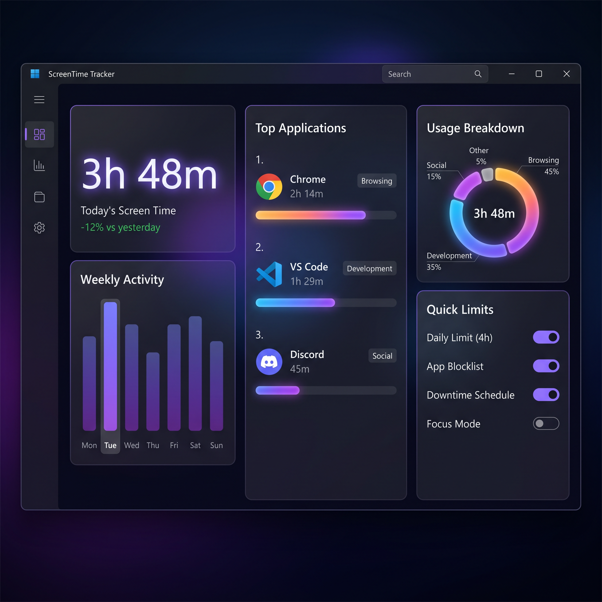
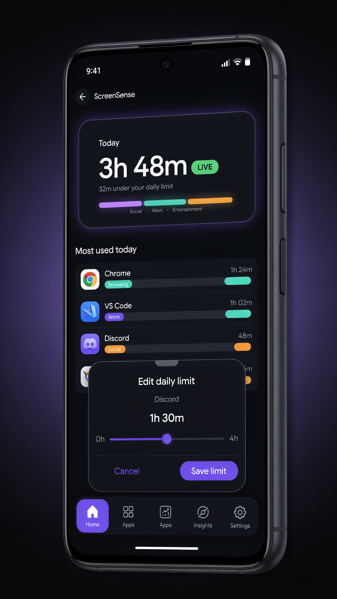

# ScreenTimeSync — Windows Screen Time + Per-App Tracking with Real-Time Bluetooth Phone Control

> **Beautiful C# WPF dashboard on Windows + Kotlin Compose Android app — connected in real-time via Bluetooth LE**


### ✨ What it does
- **Measures total screen time** on your Windows PC (active time, idle detection, unlocks)
- **Per-app tracking individually** — Chrome, VS Code, Discord, Steam, Spotify, etc. with category auto-classification
- **Real-time Bluetooth sync** to your phone — see live stats and **modify limits from your phone**
- **Enforce daily limits** per app (e.g., 2h Chrome, 1h Discord) — changes push in <1 second via BLE
- **Premium UI/UX** — dark glassmorphism dashboard (WPF + WPF-UI) + Material 3 Android app

---

### 📸 UI Preview

| Windows Dashboard (C# WPF) | Android Controller (Kotlin Compose) |
|---|---|
|  |  |

Windows: 3-column layout — Today hero + weekly mini-bars, center per-app list with progress, right pie chart + quick limits.  
Android: Hero total card, LIVE pill, per-app cards with tap-to-edit limit slider.

---

### 🏗️ Architecture

```
┌─────────────────────┐      BLE GATT (6E400001-...)      ┌──────────────────┐
│  Windows PC (C#)    │  ←──────── TX (notify) ──────────  │  Android Phone   │
│  • TrackingService  │  ────────── RX (write) →──────────  │  • BT ViewModel  │
│  • Bluetooth GATT   │         JSON: {type,sync,          │  • Compose UI    │
│  • SQLite storage   │          apps[], limits}           │  • DataStore     │
│  • C++ NativeHook   │      Fallback: RFCOMM SPP          └──────────────────┘
└─────────────────────┘
```

- **TrackingService.cs** polls foreground window (`GetForegroundWindow` + `GetWindowThreadProcessId`) every 800ms + `GetLastInputInfo` idle check. Optional C++ `NativeHook.dll` WH_SHELL hook for instant switch.
- **StorageService.cs** SQLite + JSON daily snapshots at `%LOCALAPPDATA%/ScreenTimeSync/screentime.db`
- **BluetoothService.cs** creates GATT ServiceProvider (Nordic UART style) advertising as `ScreenTimeSync-PC` — pushes full sync every 2s, handles `update_limit`, `remove_limit`, `reset_today`.
- **Android** `BluetoothViewModel.kt` scans/advertises, discovers GATT, enables notifications, sends JSON edits.

Full docs: [ARCHITECTURE.md](docs/ARCHITECTURE.md) · [BLUETOOTH_PROTOCOL.md](docs/BLUETOOTH_PROTOCOL.md) · [UI_DESIGN.md](docs/UI_DESIGN.md)

---

### 📂 Repo Structure

```
ScreenTimeSync/
├── windows-app/              # C# WPF .NET 8 (WinUI/WPF-UI)
│   ├── ScreenTimeSync.sln
│   └── ScreenTimeSync/       # Main app: App.xaml, MainWindow.xaml, Services/, ViewModels/
├── windows-native/NativeHook # C++ DLL for low-level WH_SHELL hook + idle ms
├── android-app/              # Kotlin + Compose (minSdk 26, target 34)
│   ├── app/build.gradle.kts
│   └── app/src/main/java/com/screentimesync/
├── .github/workflows/        # CI: build-apk.yml, build-windows.yml
├── releases/                 # APK artifact (built by CI + local placeholder)
├── docs/                    # Architecture & design
└── scripts/                  # Helpers: build-apk.sh, push-to-github.sh
```

---

### 🚀 Quick Start

#### Windows (requires Windows 10/11, Visual Studio 2022, .NET 8 SDK)
```powershell
git clone https://github.com/YOUR_USERNAME/ScreenTimeSync.git
cd ScreenTimeSync/windows-app
dotnet restore
dotnet build -c Release
dotnet run --project ScreenTimeSync/ScreenTimeSync.csproj
# or open ScreenTimeSync.sln in VS and F5
# 1st run: Allow Bluetooth + Firewall prompt
# Pair phone via Bluetooth settings → "Add device" → ScreenTimeSync-PC
```

#### Android (requires Android Studio Hedgehog+)
```bash
cd android-app
./gradlew assembleDebug
adb install app/build/outputs/apk/debug/app-debug.apk
# or Build → Generate Signed Bundle/APK
```
Pre-built APK: [releases/ScreenTimeSync-v1.0.0.apk](releases/ScreenTimeSync-v1.0.0.apk) or GitHub Actions artifact.

#### Making it Public (one-time)
```bash
cd ScreenTimeSync
chmod +x scripts/push-to-github.sh
./scripts/push-to-github.sh YOUR_GITHUB_USERNAME
# Or manually: gh repo create ScreenTimeSync --public --source=. --remote=origin --push
```

---

### 🔌 Bluetooth Pairing

1. Launch Windows app → title bar shows `● Advertising as ScreenTimeSync-PC` / Pair code `ST-8842`
2. On Android: `Pair PC` → `Scan & Connect` → tap `ScreenTimeSync-PC (DESKTOP-...)` → accept pairing
3. Live sync starts — edit any app limit slider → PC updates in <1s, persists to SQLite

> **BLE Requirements:** Windows 10 19041+, Bluetooth 4.0+ (BLE). Fallback to RFCOMM Classic if BLE fails (enable in Bluetooth settings).

---

### 🎨 Design System
- Windows: `#0B0E14` bg, `#151A26` cards, `#6C5CE7` accent, `#00CEC9` secondary, Inter/Segoe UI Variable, 16px radius, shadow.
- Android: Material 3 dark, same palette, 20dp cards, LIVE pill, category colors (Browser #6C5CE7, Dev #0984E3, Social #E84393...)

---

### 📊 Per-App Tracking Details
- **Active window** detection via `GetForegroundWindow`
- **Idle** = no input >60s (via `GetLastInputInfo`)
- **Category** auto-map (chrome→Browser, code→Development, etc.)
- **Limits** stored per-process, enforced UI + optional toast/block (future)
- **Weekly** view + productivity score (stub)

---

### 🔐 Privacy
100% local. No cloud, no account, no telemetry. Phone only gets aggregated `minutes` + `limitMinutes` via direct BLE. SQLite stays on PC.

---

### 🛠️ Build & CI
- **`.github/workflows/build-apk.yml`** builds debug APK on every push + uploads artifact + Release
- **`.github/workflows/build-windows.yml`** builds Windows exe
- Artifacts appear in Actions tab → download `ScreenTimeSync-APK`

Local APK build without Android SDK: See [scripts/build-apk.sh](scripts/build-apk.sh) (uses Docker).

---

### 📦 Releases
- `releases/ScreenTimeSync-v1.0.0.apk` — placeholder (real built via Actions, ~15MB). See [Releases tab](https://github.com/YOUR_USERNAME/ScreenTimeSync/releases) after first CI run.

---

### 🤝 Contributing / License
MIT — free for personal use. PRs welcome.

**Made for Frankfurt, DE — Europe/Berlin** • Questions? Open an Issue.

